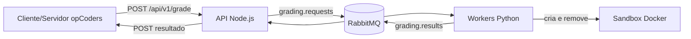

# Serviço Corretor

Sistema distribuído de correção automática de código, parte do opCoders Judge. Recebe submissões por uma API HTTP, enfileira no RabbitMQ, executa cada uma em um container Docker isolado e entrega o resultado ao servidor do opCoders.

Hoje o corretor avalia submissões em **Python** (sem etapa de compilação).

## Visão geral



## Início rápido

```bash
cp .env.example .env                       # ajuste os valores
docker build -t runner-sandbox ./runner-sandbox
docker compose up --build
curl http://localhost:3000/                # {"message":"O servidor node js está funcionando"}
```

O worker cria os sandboxes a partir da imagem `runner-sandbox`, então ela precisa existir no host antes de subir os workers.

**A confirmar:** nomes dos serviços e arquivos do compose no seu repositório.

## Documentação

| Documento | Para quê |
|---|---|
| [docs/arquitetura.md](docs/arquitetura.md) | Componentes, fluxo de uma submissão, filas e garantias de entrega |
| [docs/api.md](docs/api.md) | Endpoints HTTP, payload de submissão e formato do resultado |
| [docs/worker.md](docs/worker.md) | Módulos do worker, ciclo de vida da mensagem (ack/nack) e escalabilidade |
| [docs/sandbox.md](docs/sandbox.md) | Imagem `runner-sandbox`, limites de recursos, vereditos e limitações |
| [docs/configuracao.md](docs/configuracao.md) | Variáveis de ambiente de cada serviço |
<!--| [docs/testes-de-desempenho.md](docs/testes-de-desempenho.md) | Teste de makespan e teste de rampa com k6 |-->
| [docs/operacao.md](docs/operacao.md) | Subir, escalar, limpar filas, rede e solução de problemas |

## Estrutura do repositório

```
.
├── node-api/         # API Node.js (ajuste o nome da pasta)
├── worker/           # consumidor Python: config, messaging, grading, sandbox, worker
├── runner-sandbox/   # imagem que executa o código do aluno
├── docs/             # documentação por responsabilidade
└── .env.example
```